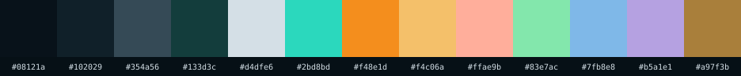

# Duck — an Omarchy theme

A dark teal theme from the duck app's palette, with the logo's orange beak as the accent, two pixel-duck backgrounds, and an optional `SUPER + ALT + D` shortcut that opens duck in a terminal.





## Install

```bash
omarchy theme install https://github.com/Drache93/omarchy-duck-theme
```

## Duck shortcut (optional)

Requires `duck` to be installed.

```bash
~/.config/omarchy/themes/duck/install-extras.sh
```

This adds:

- `~/.local/bin/omarchy-agent-duck` — launches duck the way Omarchy launches its coding agents
- the Duck app icon, themed from `icon_mark`
- `SUPER + ALT + D` in `~/.config/hypr/bindings.lua` (skipped if already there)

## Update

```bash
omarchy theme update
```
